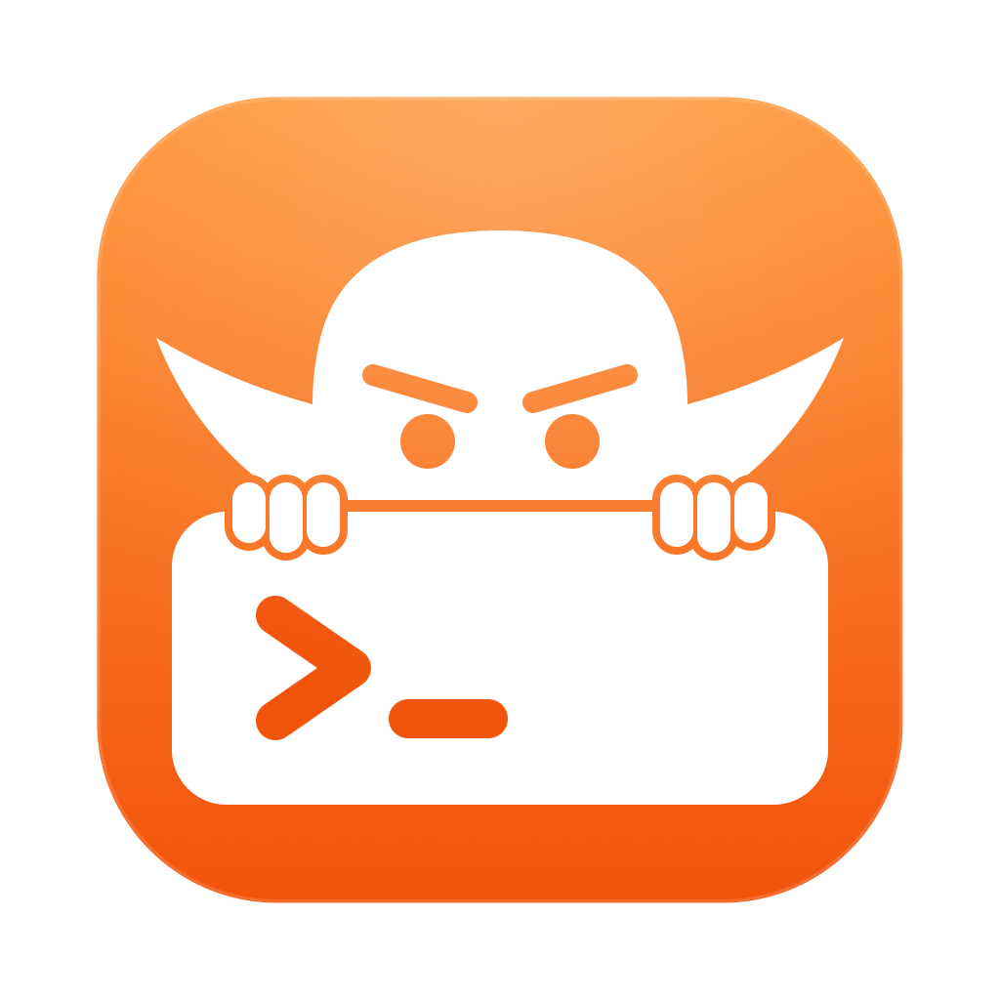
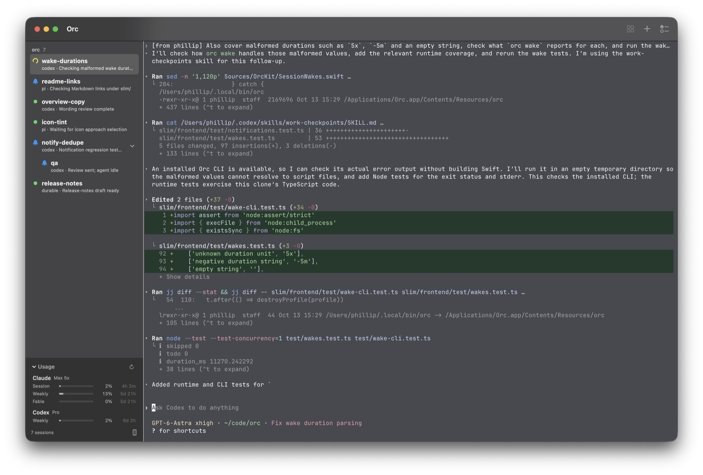
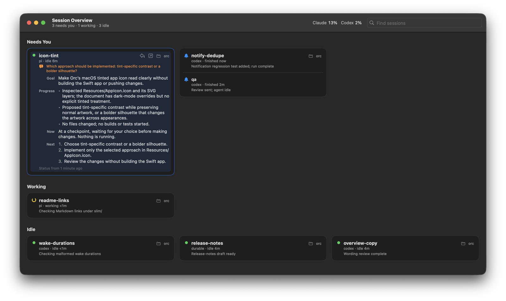
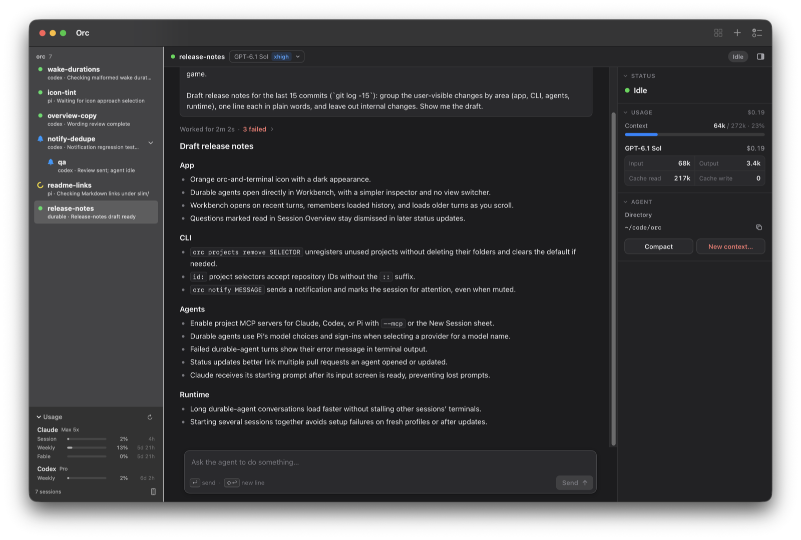

<p align="center">
  
</p>

<h1 align="center">Orc</h1>

<p align="center">
  <strong>A native macOS home for your coding agents.</strong><br>
  Run Codex, Claude Code and Pi side by side, see at a glance which ones need you,<br>
  and pick any of them up from the app, the terminal or your phone.
</p>

<p align="center">
  <a href="#install">Install</a> ·
  <a href="#quick-start">Quick start</a> ·
  <a href="#documentation">Documentation</a> ·
  <a href="docs/development.md">Development</a>
</p>

<p align="center">
  
</p>

Orc keeps every agent and shell you run in one window. Sessions run in a background runtime, so they keep going when you close the app, and Orc tells you which ones have finished, which are waiting on an answer, and which are still at work.

## Features

- **Sessions that keep running.** Agents and shells run in Orc's background runtime. Close the app or update it and they carry on; restart your Mac and they come back under the same names, agents continuing their conversations.
- **Native terminals.** Each session opens in an embedded [Ghostty](https://ghostty.org) terminal that uses your Ghostty theme, font and keybinds.
- **Session Overview.** Every session sorted into Needs You, Working and Idle, with what each agent is doing and any question it is waiting on you to answer.
- **Agent status.** A model you choose reads each agent's transcript and writes its goal, progress and next steps, without interrupting the agent.
- **Agents that work together.** Agents spawn, message and wait for each other by name, schedule wake-ups for themselves, and notify you when they have something to report.
- **Pull request follow-up.** Orc watches the pull requests your agents open and tells them about failed checks, review comments and merge conflicts.
- **A CLI for everything.** `orc` creates, attaches to and manages the same sessions from any terminal.
- **Your phone, too.** Pair the Orca mobile app to watch and type into sessions over your local network or Tailscale.

### Session Overview

<p align="center">
  
</p>

Press ⇧⌘O to see every session at once. Select one to read its full status, reply to it, or open it.

### Workbench (experimental)

<p align="center">
  
</p>

Orc's own durable agent keeps its conversation in a database, so it picks up mid-turn after a crash or restart. It opens in the Workbench, a chat view with the agent's work folded into each turn and the files it changed one click away.

## Install

Orc is built from source; there are no signed releases yet. You need an Apple Silicon Mac with macOS 14 or later, Xcode with the macOS SDK, Python 3.12+ and npm.

```sh
git clone https://github.com/phillipleblanc/orc.git
cd orc
xcodebuild -downloadComponent MetalToolchain   # if Xcode doesn't have it yet
bash scripts/build.sh
bash scripts/install.sh
open /Applications/Orc.app
```

The installer puts Orc in `/Applications` and links the `orc` command at `~/.local/bin/orc`. Install the agents you want to run (Codex, Claude Code, Pi) so your login shell can find them.

## Quick start

```sh
orc projects add ~/code/my-project --default   # Register a project
orc new                                        # Start the default agent and attach to it
orc new claude --name fix-login                # Start Claude Code under a name
orc attach                                     # Pick a session to attach to
orc agent spawn codex write-tests < task.md    # Start an agent on a task
orc agent wait write-tests                     # Wait until it finishes
```

In the app, ⌘N starts a session, ⇧⌘O opens the Session Overview, and ⌥⌘S shows the selected agent's status.

## Documentation

- [Sessions](docs/sessions.md): names, child sessions, reopening closed agents, restarting your Mac
- [The Orc app](docs/app.md): the main window, Session Overview, status panel, notifications and terminals
- [The `orc` command](docs/cli.md): creating and attaching to sessions, projects and defaults
- [Agents](docs/agents.md): messaging, wakes, agent status, pull requests, MCP servers and durable agents
- [Pair a phone](docs/phone.md) or [a computer](docs/computers.md)
- [Windows client (experimental)](windows/README.md): drive a Mac's sessions from a Windows PC on the same network
- [Development](docs/development.md): building, architecture and tests
- [Runtime design](slim/README.md)

## Acknowledgements

Orc embeds [Ghostty](https://ghostty.org)'s terminal through libghostty, uses [libsodium](https://doc.libsodium.org/) and [Node.js](https://nodejs.org/), and builds its durable agent on [pi-durable](https://www.npmjs.com/package/@earendil-works/pi-durable). Its runtime speaks the Orca protocols, so the Orca mobile app works with it unmodified.
